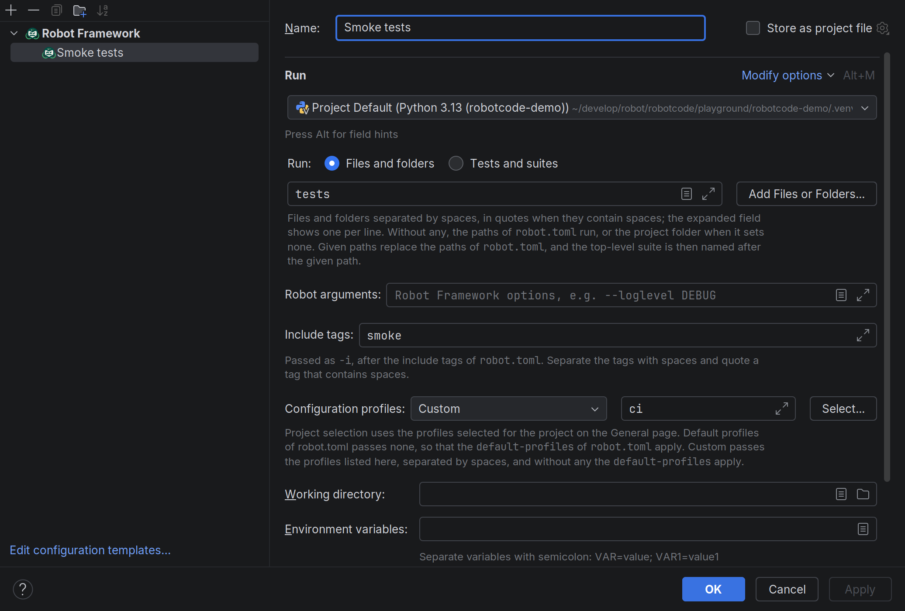
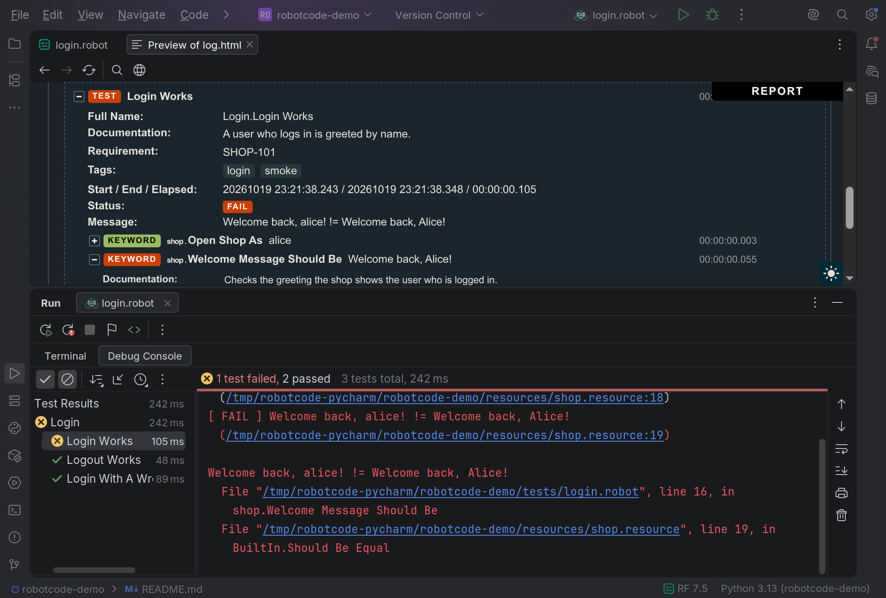
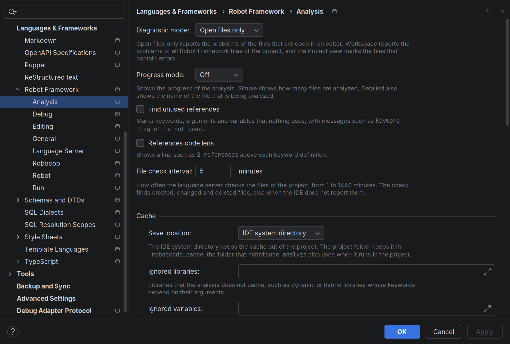
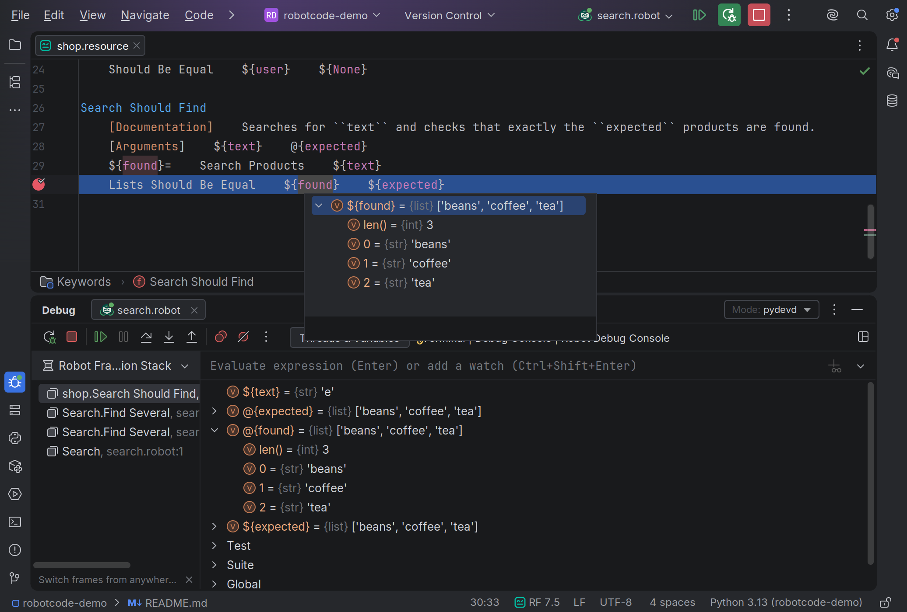

import ThemeImage from "../../../components/ThemeImage.astro";

**RobotCode** v2.8.0 is a big release. It supports Robot Framework 7.5 and is the biggest update yet for PyCharm, where **RobotCode** now offers nearly everything it offers in VS Code, from run configurations and debugging to test results and settings. VS Code gets a Documentation Viewer and follows your Python environment by itself, and the website has moved to a new platform with a new structure, a polished design and new guides, along with much more.

Not everything is perfect yet, and there is still quite a bit of work ahead, but we are working on it. I look forward to feedback, reviews and suggestions for improvement from the community.

{/* excerpt */}

## Highlights

- [Robot Framework 7.5 support](#robot-framework-75-support): See the argument descriptions that libraries document while you type, and run, list or inspect only the tests with certain metadata.
- [Documentation Viewer](#documentation-viewer): Read the documentation of any library or resource file in a VS Code editor tab, right next to your code, one click away from a hover, and bookmark what you look up often.
- [PyCharm](#pycharm): The plugin's biggest update yet brings nearly everything the VS Code extension offers: run and debug your tests with run configurations and `robot.toml` profiles, see in the results where a test failed, use breakpoints with conditions and hit counts and the new Robot Debug Console, and set almost everything you can set in VS Code.
- [Python environments in VS Code](#the-python-environment): **RobotCode** uses the environment of the new Python Environments extension and picks up another environment or a fresh Robot Framework installation by itself, without restarting VS Code.
- [A new website](#a-new-website): robotcode.io has moved to Astro with Starlight, is reorganized, has a polished design and new guides for VS Code, PyCharm and `robot.toml`.

## Breaking Changes

- **The VS Code extension needs VS Code 1.127 or newer.** Older VS Code versions keep the newest **RobotCode** release they can install.
- **The PyCharm plugin needs PyCharm or IntelliJ IDEA 2026.1 or newer.** Older IDE versions no longer receive plugin updates.
- **`--tags` is now `--show-tags`.** In `robotcode discover` and `robotcode results show`, the switch that prints the tags of each test is renamed to `--show-tags / --no-show-tags`, to match the new `--show-metadata`. The old name is no longer accepted, so update any scripts that use it.
- **A profile name that selects no profile now stops the command.** If a name or pattern from `-p`, `ROBOTCODE_PROFILES`, the editor's selection or `inherits` matches no profile, the command ends with exit code 252 before anything runs, instead of running with a different configuration. ["No profile matches"](/guides/robot-toml/troubleshooting/#no-profile-matches) explains what to do.

## Robot Framework 7.5 Support

**RobotCode** now supports Robot Framework 7.5 and brings its new features into your editor and onto the command line. What is new in Robot Framework 7.5 itself is described in the Robot Framework documentation; here is what you get in **RobotCode**.

### Richer Keyword Documentation

With Robot Framework 7.5, keywords can describe their arguments, return values and exceptions in Google style, with `Args:`, `Returns:` and `Raises:` sections. **RobotCode** shows these descriptions where you need them. The hover of a keyword lists its arguments with their descriptions, followed by the return value and the exceptions:

<ThemeImage
  name="writing-hover-arguments"
  alt="The hover of the keyword Get From List from the Collections library: its arguments list_ and index with their types and descriptions, the return type with the description of the returned value, and IndexError under Raises."
/>

While you type the arguments of a keyword call, the signature help now also shows the description of the argument at the cursor, right below the signature:

<ThemeImage
  name="writing-signature-help-arguments"
  alt="The signature help of the keyword Get From List below its call, with the argument index highlighted and, below the signature, its description from the documentation: Index of the value to get."
/>

Libraries can now also write their documentation in Markdown, as the standard libraries do, and **RobotCode** renders it.

:::caution[Libdoc HTML needs the `markdown` package]
Because the standard libraries are now documented in Markdown, the deprecated *Open Documentation* and `robotcode libdoc` need the optional Python package [`markdown`](https://pypi.org/project/Markdown/), which **RobotCode** does not ship. Install it into your project's Python environment if you use them. Hover, completion, the [Documentation Viewer](#documentation-viewer) and `robotcode doc` work without it; [Optional Python Packages](/getting-started/#optional-python-packages) has the details.
:::

### Test and Task Metadata

Robot Framework 7.5 lets tests and tasks carry their own `[Metadata]`:

```robot
*** Test Cases ***
Login Works
    [Metadata]    Issue    4409
    Open Login Page
```

**RobotCode** shows this metadata in the hover of a test and offers the new `${TEST_METADATA}` variable in completion.

You can also run, list and inspect only the tests with certain metadata. `-btm/--by-test-metadata` and `-ebtm/--exclude-by-test-metadata` take patterns like tag patterns and work with `robotcode robot`, `discover` and `results`. `robotcode discover metadata` lists the metadata in use.

```bash
robotcode robot -i smoke -btm Issue:4409   # run the smoke tests for issue 4409
robotcode discover metadata --values       # the metadata names and values in use
```

With the pre-run modifiers of the `robotcode-modifiers` package, the selection also works with plain `robot` and in `robot.toml` profiles. [Selecting by test metadata](/guides/cli/discovering-tests/#selecting-by-test-metadata) describes the patterns and how to use them.

### Also on Robot Framework 7.5

- **Markdown files:** `Resource` imports accept Markdown files (`.md`, `.markdown`, `.robot.md`). **RobotCode** also finds the tests in `.robot.md` files, but Robot Framework 7.5 reports their line numbers relative to the code blocks instead of the file, so their run buttons appear at the wrong lines. The bug is reported ([robotframework#5801](https://github.com/robotframework/robotframework/issues/5801)) and its fix is planned for Robot Framework 7.5.1; once that release includes it, the buttons will appear in the right place.
- **`robot.toml`:** `console` takes a custom console class or module, the `libdoc` formats accept `MARKDOWN`, and the `[rebot]` section takes the new `console` and `quiet` options.
- **Deprecation:** A `Tags:` section in keyword documentation without an empty row before it gets a warning, as Robot Framework 7.5 deprecates the missing empty row.

## VS Code

### Documentation Viewer

The VS Code extension has a new **Documentation Viewer**. It shows the documentation of any library, resource file or suite file in an editor tab, and it matches your project, because it is generated with the installed library versions and your project's settings. You open it with:

- A click on a link in a **hover**.
- **Show in Documentation Viewer** in the *Source Action…* menu of a `Library` or `Resource` import, a keyword call or a keyword definition.
- The book button in the **Keywords** view.
- **RobotCode: New Documentation Viewer** in the command palette or the button at the end of a viewer's toolbar, for any library or file.

<ThemeImage
  name="viewer-window"
  alt="The Documentation Viewer with ShopLibrary: the toolbar with the target field, the outline with the keywords and data types on the left and the page of the library on the right."
  full
/>

You can open several viewers at the same time, each with its own library or file, and arrange them like any other editor: side by side, in other editor groups or in a window of their own. *Show in New Documentation Viewer*, offered next to *Show in Documentation Viewer*, opens another one, and the pin in a viewer's toolbar decides which viewer the next action uses.

<ThemeImage
  name="viewer-side-by-side"
  alt="Two Documentation Viewers side by side: ShopLibrary on the left, the Collections library on the right."
  full
/>

Bookmarks take you back to the documentation you look up often. The star after the target field bookmarks the place a viewer shows, such as a library or a keyword in it, and the new **Documentation Bookmarks** view in the Explorer lists your bookmarks: a click shows one in the viewer, and buttons in its title bring the viewer to the front or open a new one. A bookmark holds for its workspace folder until you move it to *All Workspaces*, where it holds in all your workspaces and reaches your other machines with Settings Sync. On its first start, **RobotCode** bookmarks the standard libraries in *All Workspaces*.

<ThemeImage
  name="viewer-bookmarks"
  alt="The Documentation Bookmarks view in the Explorer, with the standard libraries from BuiltIn to XML under All Workspaces and, under the workspace folder robotcode-demo, the bookmarks Collections › Get From Dictionary and ShopLibrary. On the right, the Documentation Viewer shows the selected bookmark, the keyword Get From Dictionary, with a filled star after the target field."
  full
/>

While you type a target, the field offers your bookmarks and completes the names of libraries, resource files and suite files, and the context menu of the outline opens the file that defines a keyword, also the Python file of a library such as `Collections.py`. [Documentation Viewer](/guides/vscode/documentation-viewer/) in the VS Code guide has the details.

*Open Documentation*, which shows Robot Framework's Libdoc HTML, is now marked as deprecated in favor of the viewer, as is *Show Documentation* in the context menu of the **Keywords** view. Both keep working.

### The Python Environment

**RobotCode** now works with the new Python Environments extension and uses the environment it selects for a folder. Select another environment or install Robot Framework, and **RobotCode** picks up the change by itself: it restarts the language server, without a restart of VS Code. If something is missing, a message tells you what, instead of a dialog that waits for an answer. [The Python environment](/guides/vscode/configuration/#the-python-environment) has the details.

### Test Runs in RobotCode's Own Terminal

Tests now run in a terminal of RobotCode's own, whether you start them from the Test Explorer, the editor or a launch configuration. Robot Framework runs there without a shell, so every run gets the same environment, the interpreter of its workspace folder, and no activation command of the Python extensions lands in the middle of a run. Before each run, the terminal shows the run's command line as you would type it, with its profiles and options; VS Code's command decoration copies the command or the output, and the terminal is reused for the next run. [The output of a run](/guides/vscode/running-and-debugging/#the-output-of-a-run) has the details. Set [`robotcode.debug.defaultConsole`](/reference/vscode-settings/#robotcode.debug.defaultConsole) to `integratedTerminal` to run in a shell of VS Code's integrated terminal as before.

### See Where a Test Failed

A failed test now shows each of its failures in the editor, at the step of the test that led to it. A click on its marker opens a peek below the step with the whole message and the calls from the step to the line that failed, each with a few lines of its code, so you see at once where the test went wrong. Failures that the test caught, for example with `TRY`/`EXCEPT`, are listed too, marked as caught.

<ThemeImage
  name="test-explorer-window"
  alt="The Testing view with the suites and tests of the demo project after a run, all passed except Login Works; in the editor, a peek below the step of Login Works that failed shows the failure message and the call of Should Be Equal in shop.resource."
  full
/>

When a debug run stops at a failure, the editor shows the failed keyword and its message below the line and lists the same calls, with links to their lines. [Running and debugging](/guides/vscode/test-explorer/#running-and-debugging) in the Test Explorer guide and [Stopping at failures](/guides/vscode/running-and-debugging/#stopping-at-failures) have the details.

### Also in VS Code

- The language server starts as soon as you open a folder with Robot Framework files, not only when you open one of them.
- When VS Code restores an open Robot Framework file at startup, the Keywords view shows its keywords as soon as the language server runs, and canceled requests of the view no longer show up as errors in the output. ([#644](https://github.com/robotcodedev/robotcode/issues/644))
- The Test Explorer follows every change of suite files and folders, also changes made outside VS Code, for example by `git` or in a terminal, keeps its results in projects with several paths in `robot.toml`, and *Run Tests* runs every workspace folder. [Where the tests come from](/guides/vscode/test-explorer/#where-the-tests-come-from) describes when it updates.
- An empty Test Explorer says why and offers what helps: without a Python environment with Robot Framework, for example, it offers *Select Python Environment*; see [Problems while finding the tests](/guides/vscode/test-explorer/#problems-while-finding-the-tests). A failed discovery no longer leaves the suites of the last discovery next to its error.
- The language status marks only the item with the problem: when the environment has no Robot Framework, only the Robot Framework item shows an error, not the Python item.
- *RobotCode: Copy Environment Info*, also in the RobotCode menu of the language status, copies the versions of VS Code, **RobotCode**, the operating system, Python, Robot Framework and Robocop for an issue, a forum post or a chat. ([#260](https://github.com/robotcodedev/robotcode/issues/260))
- *RobotCode: Start Terminal REPL* runs the [REPL](/guides/vscode/repl/) with the folder's Python environment, not with the first `robotcode` on the `PATH`.
- Code blocks marked `robotframework` or `robot` in Markdown get Robot Framework colors in the Markdown preview and in the Documentation Viewer.
- Breakpoints with a hit count stop at that hit, and hit counts such as `>= 3` or `% 2` work; [Debugging](/guides/vscode/running-and-debugging/#debugging) lists the forms.
- After Stop, a breakpoint in a teardown no longer pauses the run again.
- The `robotcode` command in VS Code's terminals also works on systems without bash and when the extension's path contains a space, for example from a Windows user name.

## PyCharm

For PyCharm and IntelliJ IDEA, this release is the biggest step since the plugin's first version. Up to v2.7.0, the plugin brought the language features of **RobotCode**, such as completion, hover, diagnostics and navigation, while running, debugging and the settings offered much less than in VS Code. Now it offers nearly everything the VS Code extension does: you configure **RobotCode** on settings pages with the names you know from VS Code, run and debug your tests with run configurations and profiles, and see right in the results where a test failed. That makes it one of the most complete Robot Framework plugins for PyCharm. A few things are still missing, such as the Test Explorer and the Documentation Viewer, and we are working on them; [RobotCode in PyCharm and VS Code](/guides/pycharm/compared-with-vscode/) compares both, and the new [PyCharm guide](/guides/pycharm/) shows how to work with the plugin.

- **Run configurations as in VS Code.** Robot Framework run configurations now keep what they run, files and folders or tests and suites, across restarts, can be stored with the project and are edited in the IDE's run configuration editor, with the interpreter, environment variables, the Robot Framework options and the run and debug options of VS Code's launch configurations, such as a launch wrapper like `xvfb-run`. A run configuration can use the `robot.toml` profiles selected for the project or its own, and *Run with Profile…* in the gutter runs a test or suite once with another profile. Runs from the gutter reuse their configuration instead of creating copies, and the editor of a run configuration shows when its interpreter lacks Robot Framework, a target path is missing or a selected test is gone. ([#418](https://github.com/robotcodedev/robotcode/issues/418))

  

- **Run tests from every context.** Ctrl+Shift+F10 (Ctrl+Shift+R on macOS) runs the test at the cursor or the suite of the file, several selected files or folders run together, and suites in the results tree can be run again. With Robot Framework 6.1 and newer, a run of a single test or suite parses only the files it needs, and the tasks of RPA suites get run markers too. ([#631](https://github.com/robotcodedev/robotcode/issues/631))
- **Test results that show where a test failed.** A failed test lists each of its failures with the calls that led to it, from the call in the test inward, with links to their lines, and a double-click opens the call in the test that led to the first failure. Selecting a test shows the log messages it wrote, and the output of the run has a *Terminal* tab of its own. *Rerun Failed Tests* runs exactly the tests that failed, and report and log open in a preview tab whose toolbar switches between them. ([#528](https://github.com/robotcodedev/robotcode/issues/528))

  

- **Almost everything you can set in VS Code, you can now set here too.** Settings pages under *Languages & Frameworks › Robot Framework* cover Robot Framework options such as the Python path and variables, editing and completion, analysis and diagnostics, Robocop, running and debugging, the language server and the command line, with the names VS Code uses. You can select the configuration profiles of your `robot.toml` and switch RobotCode off for a project, and the status bar shows the Robot Framework version and the selected profiles. The analysis cache no longer lands in the project folder, where the IDE indexed it.

  

- **Content and source roots are on the Python path.** The analysis, test discovery and runs find libraries and resource files in the project's content roots and in folders marked as Sources or Test Sources, as PyCharm's Python run configurations do; two switches on the Robot settings page turn this off. ([#430](https://github.com/robotcodedev/robotcode/issues/430))
- **Completion in `robot.toml`.** PyCharm completes the settings of `robot.toml` and `.robot.toml` from **RobotCode**'s schema, without a schema mapping by hand, and Markdown code blocks marked `robot` are highlighted as Robot Framework code, like those marked `robotframework`.
- **Breakpoints with conditions, log messages and hit counts.** Line breakpoints get a condition, a log message and a hit count, and the IDE applies their suspend policy and options such as *Remove once hit*. Changes to breakpoints take effect at once in a running debug session, Run to Cursor always reaches its line, and the *Any Exception* breakpoint, which never reached the debugger, is replaced by Robot Framework exception breakpoints for failed keywords, tests and suites.
- **A Robot Debug Console and values on hover.** While a run is paused, the new Robot Debug Console, Evaluate Expression and watches complete the keywords and variables of the paused run, hovering a variable shows its value, lists expand into their items, and Set Value changes variables. Watches work as in VS Code, and running, stepping and evaluating no longer freeze the IDE. Stop ends a run gracefully, also while it is paused, so the run still writes its output, log and report.

  

- **Colors come from the active color scheme.** Variables, keyword calls, operators and numbers get colors from your scheme instead of plain text, and the plugin no longer ships its own colors for Darcula, Dark and Light. Colors you set on the Robot Framework color settings page are kept, and type hints and parameters have color settings of their own. ([#655](https://github.com/robotcodedev/robotcode/issues/655))
- **Test case and keyword names are highlighted right away.** Their colors no longer wait for the language server.
- **Show Usages finds more and names what it searches for.** In Robot Framework files, Show Usages and Find Usages search for the name at the cursor, as VS Code does, and name its kind and name, such as "Keyword Open Shop As", instead of "LSP Usage Triggered Psi Element". They find the usages of a keyword called with a library prefix, such as `BuiltIn.Log`, and on a resource import they list where the file is imported and where its keywords are called with its name in front. LSP Reference(s) now also works on library keywords and on variables from Python variable files.
- **The Python environment is checked in the background.** The check no longer blocks the editor and says what is wrong, such as an old Python or Robot Framework version or a missing Robot Framework; a banner offers to choose another interpreter, to check again or to switch RobotCode off for the project. RobotCode starts only in projects with Robot Framework files or a `robot.toml`.
- **A sturdier language server.** Its output no longer shows up as IDE errors, a start that fails ends with a message instead of hanging, and the IDE no longer freezes when Robot Framework files are deleted, created or renamed. It restarts only when its settings change, and Restart picks up an interpreter you fixed outside the IDE.
- **Updates ask for a restart and say what's new.** Installing or updating the plugin asks for a restart of the IDE instead of leaving it without RobotCode's features, and after an update a notification offers *What's New?*, which opens these news, as in VS Code.
- **Your own templates for `.resource` files appear in the New Robot Framework File dialog.** Thanks to Pāvels Koržs.

## Language Server and Analysis

### More Robust Library Loading

A library that hangs or exits while it loads no longer holds up the editor or `robotcode analyze code`: **RobotCode** stops it after the load timeout and shows the problem at the import. Changed arguments of a library import now take effect right away, and if a library can't be set up with the given arguments, the import tells you so.

### Cleaner Keyword Completion

Keyword completion no longer offers keywords tagged `robot:private` from other files; the setting `robotcode.completion.hidePrivateKeywords` brings them back. Calls of private library keywords are now reported too, and the new setting `robotcode.completion.hideDeprecatedKeywords` leaves deprecated keywords out of the list. ([#495](https://github.com/robotcodedev/robotcode/issues/495), [#652](https://github.com/robotcodedev/robotcode/issues/652))

### Also in the language server and analysis

- Find References, Rename and the unused hints keep up with the files on disk, also with files created, changed or deleted outside the editor and with all files that import a changed resource file; a check every five minutes, set by `robotcode.analysis.fileCheckInterval`, finds the changes the editor doesn't report.
- Find References also works on the library or resource name in front of a keyword call, such as `BuiltIn` in `BuiltIn.Log`, and lists `EXCEPT AS` and item assignments such as `${items}[0]=` with the variable they set, so Rename renames them too.
- The language server now also starts when `robot.toml` can't be loaded or a profile name selects no profile, and reports the problem as an error message instead of only in its log. VS Code and PyCharm report a selected profile that `robot.toml` doesn't define and offer to remove it from the selection.
- A library import that Robot Framework 7.4 and newer ignores, because an earlier import already uses its name, is now reported.
- A file that you edited, saved and closed is no longer analyzed with the text from before your edit.
- After a change of the Python path or of an environment variable, files whose imports or variables it affects are analyzed again instead of keeping their old diagnostics, also closed ones.
- After the `languages` setting changed, files from the analysis cache are read again, so a resource file with section headers in another language no longer stays empty.
- `# robotcode:` comments that change diagnostics work as documented: `warning[…]` and `information[…]` change only the listed codes, a comment after a nested block takes effect, and the nearest comment wins.

## AI Agents

**RobotCode** comes with a chat plugin for AI agents: the VS Code extension ships it for GitHub Copilot Chat, switched on by default, and Claude Code, Codex, GitHub Copilot CLI and other agents install the same plugin from its marketplace. Its skill tells the agent how to use `robotcode` on your project and is up to date with this release: the agent now looks up keywords and libraries with `robotcode doc`, so it sees the keywords of the libraries you actually have installed, and it knows the other new commands and options, such as the selection by test metadata and the exit codes of the REPL.

The plugin now carries the version of the **RobotCode** release it belongs to. The copy in the VS Code extension always matches the extension, and every release is now tagged in the marketplace, so other agents can pin the plugin to the version of **RobotCode** that a project uses. [Working with AI Agents](/guides/ai-agents/) shows how to set it up and [how to pin it](/guides/ai-agents/#matching-your-robotcode-version).

The language model tools of the VS Code extension are now deprecated: the chat plugin replaces them, and VS Code marks the setting `robotcode.ai.enableLanguageModelTools` as deprecated. The tools keep working until a later release removes them.

## Command Line and REPL

### `robotcode doc`

The Documentation Viewer is built on the new `robotcode doc` command, which you can also use on its own in the terminal. It shows the documentation of a library, resource file or suite file the way your project sees it, with the installed library versions and your `robot.toml` profiles.

```bash
robotcode doc keywords Collections dictionary   # the keywords of Collections that match "dictionary"
```

`robotcode doc` comes with the optional `repl` package (`pip install "robotcode[repl]"`); [Browsing Library Documentation](/guides/cli/browsing-documentation/) has the details.

### A More Dependable REPL

A statement that fails without being handled now fails the REPL session, and a non-interactive session exits with 1, so scripts, CI and agents can tell success from failure. You can also choose the exit code yourself; see the [REPL reference](/guides/cli/repl/#exit-code-and-session-status). Several fixes make `robotcode repl` and the notebook kernel more reliable: `.save` leaves out inputs that failed, so the saved file runs, and settings such as `[Tags]` typed at the prompt are reported instead of silently ignored. ([#663](https://github.com/robotcodedev/robotcode/issues/663), [#667](https://github.com/robotcodedev/robotcode/issues/667))

Ctrl-C now works as in Python's REPL and in pdb: at the prompts of `repl` and `robot-debug` it drops what you typed instead of ending the session or resuming the run, and while a run executes under the debugger it pauses at the next keyword.

### Also on the command line

- On Windows, `robotcode` commands no longer fail when a given path is on another drive than the working directory.
- `robotcode discover` no longer fails when a custom parser or a pre-run modifier creates a test without a line number, so VS Code and PyCharm show the tests of such a project too.
- `robotcode results log --extract` finds screenshots whose names are URL-encoded, follows the `file:` links of the OperatingSystem library and extracts the videos the Browser library records.
- Keyword breakpoints of `robot-debug` and `.break` match names like Robot Framework, also with glob patterns such as `BuiltIn.*`.
- `robotcode analyze code` keeps its cache in the `cache-dir` set in `robot.toml`, and `discover files` takes relative paths from the folder it is started in.
- In `robot.toml`, an `extend-` setting such as `extend-variables` now adds to its setting also when both are in the same profile or file, and in `[extend-profiles.<name>]`.
- In `robot.toml`, a setting in `[rebot]`, `[libdoc]` or `[testdoc]` now wins over the same setting outside the table, and `[extend-rebot]`, `[extend-libdoc]` and `[extend-testdoc]` change these tables from a later file or a profile.
- In `robot.toml`, selecting a disabled profile no longer applies the profiles two or more levels up its inheritance chain.
- `repl`, `repl-server` and `robot-debug` end on SIGTERM, as sent by `kill` or a process manager, also while they wait for input.
- Colored output of `discover` and `results` paged through bat no longer shows an empty line after each line.

## A New Website

robotcode.io has moved from VitePress to [Astro](https://astro.build/) with [Starlight](https://starlight.astro.build/). Its pages were carried over, the design is polished, and the documentation is reorganized by what you come to do: **Getting Started** helps you install and configure **RobotCode**, **Guides** show how to work with it, and **Reference** lists the commands, the `robot.toml` and VS Code settings and the diagnostics modifiers. New guides to [VS Code](/guides/vscode/) and [PyCharm](/guides/pycharm/) show how to write, navigate, run, debug and configure Robot Framework projects there, and [Configuring Projects with robot.toml](/guides/robot-toml/) explains what `robot.toml` can do. The new [home page](/) shows **RobotCode** at work in short demos: editing in VS Code, PyCharm and Neovim, running and debugging tests, the configuration, the command line and the REPL, and an AI agent that writes, finds and fixes tests with the **RobotCode** skill. The [news](/news/) section has tags and an [RSS feed](/news/rss.xml), and after an update the What's New notification of the VS Code extension opens the newest release notes.

The reason for the move: VitePress 1 gets no further releases, and VitePress 2 has been in alpha since January 2025, without a guide for moving from version 1. VitePress 1 also depends on old versions of Vite and esbuild with known security vulnerabilities, one of them rated high, which get no fix on the 1.x line. They affected only the tools that build the site, not the published pages. Starlight, in contrast, is actively developed.

All pages have new addresses, and the old addresses are not redirected, so update your bookmarks.

## Python 3.15

**RobotCode** now also runs on Python 3.15, which Robot Framework supports from version 7.5. The CI no longer tests every Robot Framework version with every Python version, only with the Python versions that Robot Framework itself officially supports, because there would be too many combinations otherwise. This changes only what the CI tests, not which combinations **RobotCode** runs with.

## Nightly Builds

Every night, the newest build of `main` is published as a pre-release, so you can try new features and fixes before the next release. In VS Code, choose *Switch to Pre-Release Version* on the page of the RobotCode extension. In PyCharm, add `https://plugins.jetbrains.com/plugins/dev/26216` as a custom plugin repository. The Python packages are on PyPI as dev versions such as `2.8.0.dev527`: `pip install robotcode` keeps installing the latest release, and a dev version is installed only when you pin it. [Try the Dev Builds](/getting-started/dev-builds/) shows how to switch to them and how to go back to a release.

## Bug Fixes

- In VS Code, a run from the Test Explorer now ends as Robot Framework ends it: it keeps Robot Framework's exit code, and the Browser library closes its Playwright process and its browsers at the end. ([#635](https://github.com/robotcodedev/robotcode/issues/635))
- An environment variable with an empty default, such as `%{NAME=}`, is no longer reported as not found when `NAME` is not set. ([#653](https://github.com/robotcodedev/robotcode/issues/653))
- In VS Code, the exception breakpoint for failed tests stops again, and keywords you run at such a stop work, also at a failed-test stop of `robot-debug`. The exception breakpoints are now called *Failed Tests* and *Failed Suites*; if you had switched one of them on, switch it on again once after the update. ([#664](https://github.com/robotcodedev/robotcode/issues/664))
- A breakpoint condition that raises an error now shows the error, in VS Code's Debug Console and in `robot-debug`, instead of counting as true or false. ([#669](https://github.com/robotcodedev/robotcode/issues/669))
- In JetBrains IDEs, breakpoints in files of other languages, such as C# in Rider, are no longer turned into Robot Framework breakpoints. ([#658](https://github.com/robotcodedev/robotcode/issues/658))
- In a PyCharm project with several modules, **RobotCode** uses the interpreter and the roots of the module that holds the Robot Framework project, not the first module with an interpreter, and asks when several modules qualify; the General settings page can change the module. ([#489](https://github.com/robotcodedev/robotcode/issues/489))
- In PyCharm, Go to Declaration on a variable jumps to its definition again. ([#660](https://github.com/robotcodedev/robotcode/issues/660))
- In PyCharm, Go to Declaration on a keyword called with a library or resource prefix lands on the keyword every time, not only the first time. ([#464](https://github.com/robotcodedev/robotcode/issues/464))
- Closing a project or quitting PyCharm while the language server is still starting no longer reports an error. ([#630](https://github.com/robotcodedev/robotcode/issues/630))
- In PyCharm, tests whose suite teardown fails show as failed, and the run console keeps the output in the order Robot Framework wrote it. ([#458](https://github.com/robotcodedev/robotcode/issues/458))
- `--dry` no longer starts the `wrapper` configured in `robot.toml`, and `debug` and `repl-server` no longer hang with `--dry`. ([#665](https://github.com/robotcodedev/robotcode/issues/665))
- Commands that run Robot Framework exit with 252 when **RobotCode** itself reports an error, such as an invalid `robot.toml` or a wrapper that doesn't start, so a CI job can tell a broken setup from failed tests. ([#666](https://github.com/robotcodedev/robotcode/issues/666))
- The help of the REPL's `.set` and the command-line debugging guide now say that `.set` only changes existing variables and always stores a string. ([#670](https://github.com/robotcodedev/robotcode/issues/670))
- The configuration guide now names the correct location of the global user configuration: a `robot.toml` in the platform's user configuration directory (for example `~/.config/robotcode/robot.toml` on Linux), not `~/.robot.toml`. ([#637](https://github.com/robotcodedev/robotcode/issues/637))

## Under the Hood

The experimental SemanticModel introduced in v2.6.0 has made good progress: with `semantic-model = true`, semantic highlighting, selection ranges and the debugger's inline values now run on the model and behave as without it. It is still off by default; the [v2.6.0 post](/news/v2-6-0/#experimental-semanticmodel-preview) shows how to try it.

---

## Thank You

Thanks to everyone who reported issues, contributed ideas and code, and tested pre-release builds. Your feedback drives every release.

If you like **RobotCode**, please help others find it: we need more reviews in the [VS Code Marketplace](https://marketplace.visualstudio.com/items?itemName=d-biehl.robotcode) and the [JetBrains Marketplace](https://plugins.jetbrains.com/plugin/26216), and more stars on [GitHub](https://github.com/robotcodedev/robotcode). Donations through [GitHub Sponsors](https://github.com/sponsors/robotcodedev) or [Open Collective](https://opencollective.com/robotcode) are very welcome too and help keep the project sustainable.

For the full list of changes, see the [Changelog](https://github.com/robotcodedev/robotcode/blob/main/CHANGELOG.md).

- [Report issues](https://github.com/robotcodedev/robotcode/issues)
- [Discussions & Q&A](https://github.com/robotcodedev/robotcode/discussions)
